# EIO — Easy Ink OS

🇬🇧 English · 🇮🇹 [Italiano](README.it.md)

*Codename: **Calamaio** (Italian for "inkwell"). The code, the commands and the device still use that name.*

EIO is a small battery-powered e-ink screen that sits next to your computer. It shows what your Claude Code sessions are doing: which ones are working, which are waiting for a permission, which are done. The project has four parts: the **firmware** that runs on the board (ESP32-S3), a **service** that runs on your Mac and talks to Claude Code, a Claude Code **plugin** that sends events to the service, and an optional **iPhone app**.

> **Note on language.** The text shown on the device and in the web app is in Italian, and so is the documentation in `docs/`. This README keeps the exact Italian UI strings, with a short English gloss in parentheses the first time each one appears. An Italian version of this README is in [`README.it.md`](README.it.md).

> **Personal project, in development.** It has been tested on a single board (see "Designed and tested on" below). It may not work on other boards. Always make a backup before writing to the board.

## What it looks like

<table>
<tr><td align="center" width="50%">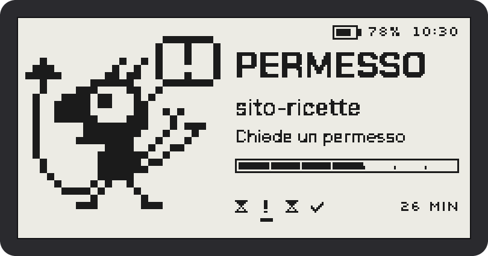<br><sub>Home (Goccia style): the session that needs attention is in the foreground</sub></td><td align="center" width="50%">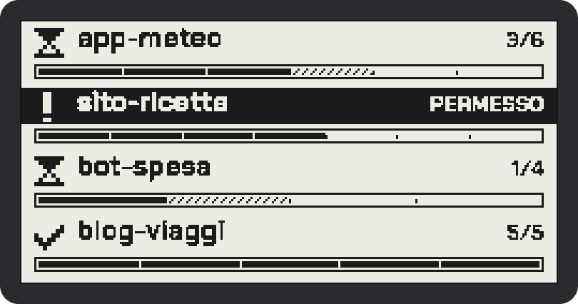<br><sub>Home, Righe (rows) style: all sessions with task progress</sub></td></tr>
<tr><td align="center" width="50%">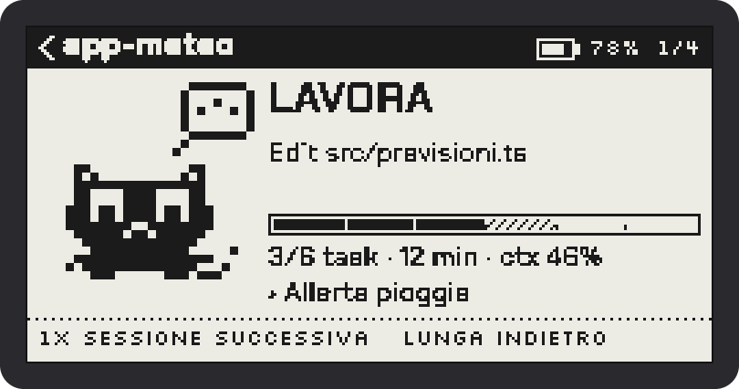<br><sub>Detail of a session at work</sub></td><td align="center" width="50%">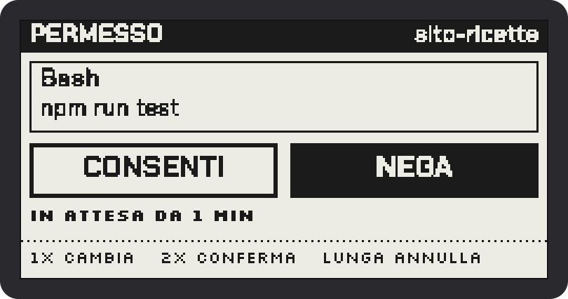<br><sub>Permission request: CONSENTI (allow) or NEGA (deny) from the display</sub></td></tr>
<tr><td align="center" width="50%">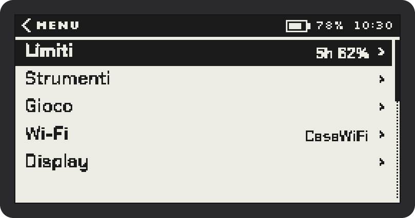<br><sub>Main menu</sub></td><td align="center" width="50%">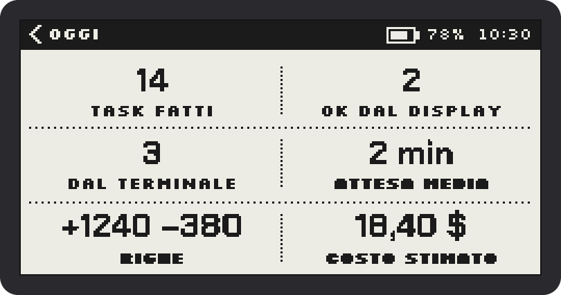<br><sub>Today: tasks, permissions, lines and estimated cost</sub></td></tr>
<tr><td align="center" width="50%">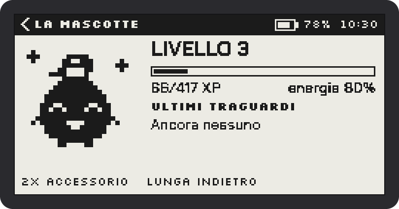<br><sub>The mascot: level, XP and energy</sub></td><td align="center" width="50%">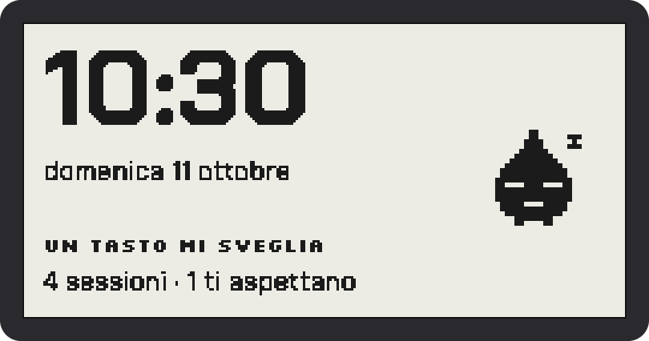<br><sub>Rest: time, date and waiting sessions</sub></td></tr>
<tr><td align="center" width="50%">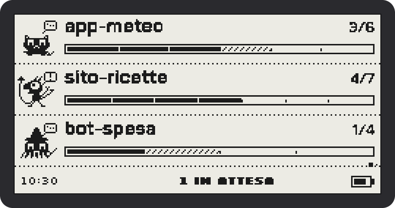<br><sub>Installed theme «Mascotte grande» (big mascot), with several sessions</sub></td><td align="center" width="50%">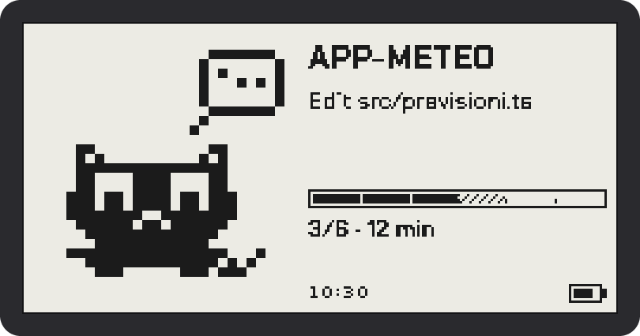<br><sub>Installed theme «Mascotte grande» (big mascot), with a single session</sub></td></tr>
<tr><td align="center" width="50%">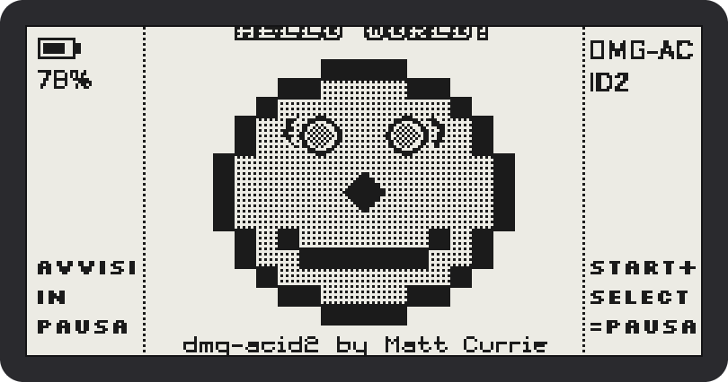<br><sub>Game Boy emulator on the e-ink display (free test ROM dmg-acid2, MIT; ROMs are not included)</sub></td></tr>
</table>

<p align="center">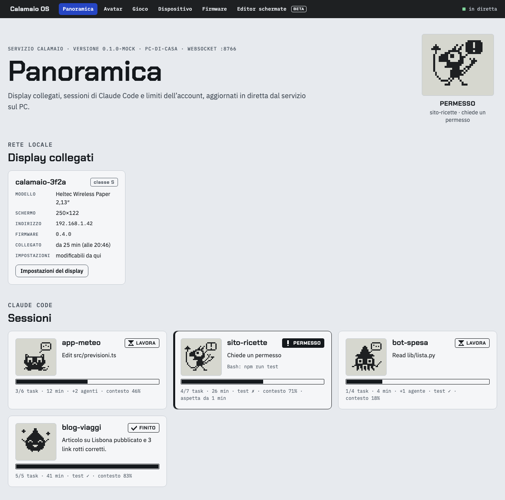<br><sub>Web app: overview of the display and the sessions</sub></p>

<p align="center">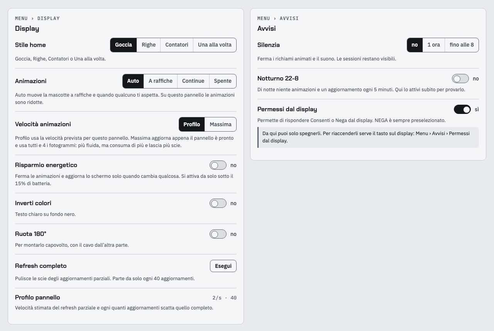<br><sub>Web app: Display and remote Alerts settings</sub></p>

<p align="center">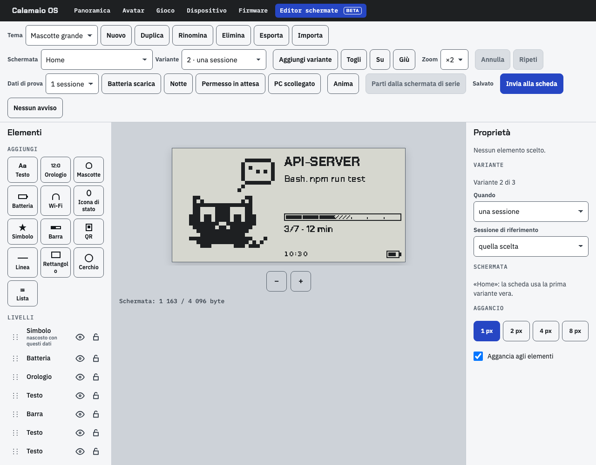<br><sub>Web app: screen editor (Beta)</sub></p>

Images generated by the firmware's drawing code with sample data (`node tools/screenshots/make.mjs`).

---

## What it does

- **Sessions**: for each Claude Code session it shows the state (working, waiting for a permission, waiting for your answer, done, in error), the project, how much of the context is used, and the usage limits.
- **Permissions from the display**: when Claude asks for permission to use a tool, you can answer CONSENTI (allow) or NEGA (deny) from the board. The safety rules, which cannot be bypassed:
  - **NEGA is always preselected**; to allow, you need two gestures: choose CONSENTI, then confirm;
  - the board must be **paired** with the PC using a 6-digit code; every answer is signed (HMAC) and valid only once (nonce): fake answers from other devices on the network are discarded;
  - **no automatic approval**, ever, for any tool;
  - Claude's **questions** (choices, plans to approve) can only be answered in the terminal;
  - the request stays open until someone answers, on the display or in the terminal: the first answer wins;
  - it can be turned off from Menu › Avvisi › Permessi dal display (Alerts › Permissions from the display);
  - the **phone used as a controller can never give CONSENTI** (nor the other sensitive confirmations: Proteggi le chiavi (Protect keys), Ripristino (Reset), pairing, deleting networks).
- **Avatars**: each session can have a different character (Goccia (drop), Gatto (cat), Demone (demon), Calamaro (squid), or ones you create), so you can tell at a glance who is calling you. Format in [`docs/AVATAR.md`](docs/AVATAR.md) (Italian).
- **Mascot and game**: the mascot earns points and milestones while you work, and unlocks avatars and accessories.
- **Themes**: the main screens can be redesigned with the web app's **screen editor** (**Beta**) and sent to the board. Format in [`docs/TEMI.md`](docs/TEMI.md) (Italian).
- **Game Boy games**: an emulator (Peanut-GB) runs on the board. You play with an Xbox controller over Bluetooth or with your iPhone as a controller. You provide the ROM yourself (see "Game Boy games").
- **iPhone app**: opens the web app from your phone (paired with a QR code) and turns the phone into a Bluetooth controller for the board.
- **Cable-free update (OTA)**: the service sends the new firmware over Wi-Fi. The image is signed, the board checks it before running it and, if the new version does not start, it goes back to the previous one by itself. Details in [`docs/OTA.md`](docs/OTA.md) (Italian).
- **Web app** at <http://127.0.0.1:8765>: overview, avatars, game, device (pairing, Wi-Fi, log), firmware (writing and backup over cable from the browser), screen editor.

---

## Designed and tested on:

All values come from [`docs/HARDWARE.md`](docs/HARDWARE.md), [`docs/DECISIONI.md`](docs/DECISIONI.md), `firmware/platformio.ini`, `firmware/partitions_gb.csv`, and from reading the board with esptool and espefuse over the USB port (17 October 2026). Where neither the documentation nor the board says anything, it says "not documented".

### Board

| Item | Value |
|---|---|
| Board | **Heltec Wireless Paper V1.2** |
| Microcontroller | **ESP32-S3FN8** (QFN56 package with the flash inside), revision v0.2, dual-core Xtensa LX7 at 240 MHz, 40 MHz crystal |
| Flash memory | 8 MB inside the chip (GigaDevice, id c8/4017, rated up to 85 °C), quad mode |
| PSRAM | **none** (verified: the board's eFuses do not declare any PSRAM) |
| RAM | 512 KB of SRAM in the chip plus 16 KB of RTC memory (ESP32-S3 datasheet); about 320 KB usable by the program (estimate in DECISIONI, entry "Game Boy Advance") |
| Screen | e-ink **E0213A367**, **2.13″**, **250×122** pixels (memory 128×250), black and white |
| Screen controller | SSD168x-family commands; exact chip model: not documented (the screen has no command that reports the model, so it cannot be read over USB) |
| Screen pins | MOSI 2, CLK 3, CS 4, DC 5, RST 6, BUSY 7; peripheral power Vext GPIO45 (active low) |
| Screen refresh | full 1540 ms, partial 644 ms (at most about 1.5 per second), initial clear 1626 ms; in games, a fast driver at about 9.8 frames per second ("Pulito" (Clean) profile) |
| Buttons | just one: **PRG** on GPIO0, active low (wakes the board from sleep). Held down while you plug in the cable, it puts the board into the serial bootloader |
| LED | GPIO18; plus an orange charge LED, connected only to the charger |
| Battery | read on GPIO20 (ADC2 channel 9) through a 1:2 divider switched on by GPIO19 (active low); battery capacity: not documented (depends on the one connected) |
| Charging | TP4054, about 500 mA (calculated from the schematic, not checked against the datasheet); stops by itself at 4.2 V; the charge state does not reach the microcontroller |
| USB-serial bridge | Silicon Labs **CP2102** (10c4:ea60), on macOS `/dev/cu.usbserial-0001` |
| Serial speed | **115200** is reliable; 460800 and 921600 give packet errors with this CP2102 |
| Wi-Fi | 802.11 b/g/n, **2.4 GHz only** (5 GHz networks are not visible); antenna: not documented |
| Bluetooth | Bluetooth 5 Low Energy (chip datasheet); the firmware uses NimBLE, central role only, for the controller |
| eFuse | 6 key slots; with "Proteggi le chiavi" (Protect keys) one becomes the board's secret key (see below) |

### Partition table (`firmware/partitions_gb.csv`)

| Name | Address | Size | What it is for |
|---|---|---|---|
| nvs | 0x9000 | 20 KB | settings, Wi-Fi networks, pairing keys (encrypted) |
| otadata | 0xE000 | 8 KB | which of the two firmware copies to boot |
| app0 | 0x10000 | 2.25 MB | firmware |
| app1 | 0x250000 | 2.25 MB | firmware (the second copy, for the cable-free update) |
| gbrom | 0x490000 | 2 MB | the Game Boy ROM |
| spiffs (LittleFS) | 0x690000 | 1.375 MB | cache of avatars, accessories and themes; game saves |
| coredump | 0x7F0000 | 64 KB | report of the last crash |

### Beware of eFuses (irreversible)

eFuses are tiny memories inside the chip that **can be written only once, forever**. Calamaio uses just one, and only if you ask for it: Menu › Sicurezza › **Proteggi le chiavi** (Security › Protect keys), with a warning, two presses, and then "hold 3 s". It writes a random key that nobody can read back, not even you; from then on the Wi-Fi password and the pairing keys are encrypted with that key. Consequences:

- **it cannot be undone**, not even by rewriting the flash or restoring a backup;
- a flash backup made on this board **will not work on another one** (the secrets are tied to this chip);
- no script in this repository writes eFuses, and it must never be done by hand.

### Software used for testing

| What | Version |
|---|---|
| Calamaio OS firmware | **0.14.1** |
| Service | 0.9.0-game |
| Plugin | 0.5.0 |
| iPhone app | 0.1.0 |
| PlatformIO platform | `espressif32@6.9.0` (Arduino core 2.0.17, ESP-IDF 4.4.7) |
| Firmware libraries | heltec-eink-modules 4.6.0, ArduinoJson 7.4.3, links2004/WebSockets 2.7.3, NimBLE-Arduino 2.5.1, Peanut-GB (commit `d0bcca7`), QRCode 0.0.1 (copied), TweetNaCl, mbedTLS 2.28.7 (from the IDF) |
| PlatformIO Core | 6.2.0 |
| Go | 1.27.2 (the code requires at least 1.24) |
| Go libraries | coder/websocket 1.8.15, brutella/dnssd 1.2.14, santhosh-tekuri/jsonschema 6.0.3, golang.org/x/term 0.21.0, rsc.io/qr 0.2.0 |
| esptool | 5.5 and 5.6 |
| Node (development tools only) | 22 |
| Xcode and XcodeGen | Xcode 27.1, XcodeGen 2.45.4 |
| iPhone | iPhone 17 Pro with iOS 27; iOS 27.0 simulator |
| macOS | 27.0.1 |
| Claude Code | 2.1.296 and later |

### Other boards

The **CrowPanel ESP32-S3 4.2″** (Elecrow) is planned (milestone M7) but **not supported yet**: there is no firmware for it. The same goes for the other boards listed in `docs/ISTRUZIONI-SVILUPPO.md`.

---

## Feature status

| Feature | Status |
|---|---|
| Claude Code sessions on the display | stable |
| Permissions from the display (pairing, signing, safety rules) | stable |
| Avatars, mascot and accessories | stable |
| Cable-free update (OTA) with automatic rollback | stable |
| Multiple Wi-Fi networks, pairing, remote log | stable |
| Service autostart at login | tested on macOS; Linux is in the code; **Windows not yet** |
| **Screen editor and themes** | **BETA**: "Parti dalla schermata di serie" (Start from the stock screen) does not exist yet; version history has no interface; invalid changes live only in the open page |
| Game Boy games | works, with limits: no audio, black-and-white image, MBC 0/1/2/3/5 cartridges, ROM up to 2 MB |
| Xbox controller and iPhone as a controller | works |
| iPhone app | in development: some sections (Firmware, log, backup) are deliberately turned off on the phone; with a free Apple ID it must be reinstalled every 7 days |
| Battery percentage | implemented; the comparison with a multimeter on the real board is still to be done |
| Firmware 0.14.1 (memory savings) | live tests on the board are still to be recorded |
| Crash reports | present; they rely on the Arduino core's coredump |

---

## Setting up the Mac

Commands are typed in the **Terminal** app. After each installation there is a command to check that it went well.

1. **Homebrew** (installs the other programs):
   ```sh
   /bin/bash -c "$(curl -fsSL https://raw.githubusercontent.com/Homebrew/install/HEAD/install.sh)"
   brew --version
   ```
2. **git** (downloads the code):
   ```sh
   brew install git
   git --version
   ```
3. **Go** (builds the service):
   ```sh
   brew install go
   go version          # must say go1.24 or newer
   ```
4. **Python 3 and uv** (needed by PlatformIO, esptool and the ROM tool):
   ```sh
   brew install python uv
   python3 --version
   uv --version
   ```
   Instead of uv, pipx works too: `brew install pipx && pipx ensurepath`.
5. **PlatformIO Core** (builds and writes the firmware):
   ```sh
   uv tool install platformio      # or: pipx install platformio
   pio --version
   ```
   If `pio` cannot be found, run `uv tool update-shell` and reopen the Terminal.
6. **esptool** (reads and writes the board's flash). You do not need to install it: `uvx` downloads it the first time you use it.
   ```sh
   uvx --from "esptool>=5.5,<6" esptool version
   ```
7. **USB-serial driver**: usually **not needed**, macOS already recognizes the CP2102. Plug the board in with a **data** cable (some cables only charge) and check:
   ```sh
   ls /dev/cu.usbserial-*
   ```
   If nothing shows up with a good cable, install the CP210x driver from the Silicon Labs website.
8. **Xcode and XcodeGen** (only for the iPhone app): install Xcode from the App Store, open it once to accept the license, then:
   ```sh
   brew install xcodegen
   xcodebuild -version
   xcodegen --version
   ```
9. **Node** (only for the web app tests and the tools in `tools/`; you do not need it to use Calamaio):
   ```sh
   brew install node
   node --version      # 22 or newer
   ```
10. **Claude Code**: follow the official instructions at <https://docs.claude.com/claude-code>, then:
    ```sh
    claude --version
    ```

Download the code:

```sh
git clone https://github.com/MrGamingITA/easy-ink-os.git
cd easy-ink-os
```

---

## ⚠️ First of all: back up the board

**Before writing anything to the board, save a complete copy of its flash memory.** If something goes wrong, the backup lets you restore the board exactly as it was (even to the factory firmware). Reading does not change anything on the board. At 115200 baud it takes about **12 minutes** for 8 MB.

Backups contain the **Wi-Fi password** and the **keys** stored on the board: keep them private. The `backup-fabbrica/` folder is excluded from git on purpose: never put a backup in the repository.

### Way 1: ROM tool (with a window, the easiest)

Double-click **`tools/rom-tool/avvia.command`** (the first time it sets up what it needs by itself; if macOS blocks it: right-click › Open). Or from the command line, after the first launch:

```sh
cd tools/rom-tool
.venv/bin/python rom_tool.py info     # chip, MAC, flash
.venv/bin/python rom_tool.py read     # full backup in <chip>_<mac>_<date-time>.bin, with the .sha256 file
```

If the read is interrupted, it resumes with `--riprendi` (resume). Full instructions in [`tools/rom-tool/README.md`](tools/rom-tool/README.md) (Italian).

### Way 2: script in the Terminal

```sh
tools/backup/backup-flash.sh                          # finds the port by itself, if there is only one board
tools/backup/backup-flash.sh /dev/cu.usbserial-0001   # or give it yourself
```

The file ends up in `backup-fabbrica/<chip>_<mac>_<date>.bin`, with `….bin.sha256` next to it, the fingerprint used to check that the file is intact (`shasum -a 256 -c file.bin.sha256`).

To put a backup back on the board (**it erases everything that is there**: before starting it asks you to type `SCRIVI` (WRITE), and `FORZA` (FORCE) if the file looks like it comes from another board):

```sh
tools/backup/restore-flash.sh backup-fabbrica/esp32s3_<mac>_<date>.bin
```

### Way 3: esptool by hand

```sh
PORTA=/dev/cu.usbserial-0001
# full backup (8 MB = 0x800000)
uvx --from "esptool>=5.5,<6" esptool --port $PORTA --baud 115200 read-flash 0 0x800000 backup-completo.bin
shasum -a 256 backup-completo.bin > backup-completo.bin.sha256
# restore (destructive: replaces the whole flash)
uvx --from "esptool>=5.5,<6" esptool --port $PORTA --baud 115200 write-flash 0x0 backup-completo.bin
```

There is also a fourth way: the **Firmware** page of the web app does backup and restore from the browser (Chrome or Edge only, which have Web Serial).

If the board does not respond: hold down **PRG** while you plug in the cable, then try again.

---

## Build and install

### 1. The service (on the Mac)

```sh
cd service
go test ./...                                       # the tests: they must all say "ok"
go build -o ~/.local/bin/calamaio ./cmd/calamaio
calamaio version
```

If `calamaio` cannot be found, add `~/.local/bin` to the PATH (`echo 'export PATH="$HOME/.local/bin:$PATH"' >> ~/.zshrc`, then reopen the Terminal).

Start it, from the root of the repository:

```sh
calamaio serve --firmware firmware/.pio/build/heltec213
```

`--firmware` is optional: it lets the web app and `calamaio ota push` know about the built firmware. Then open <http://127.0.0.1:8765>. To try the screen without Claude Code: `calamaio serve --fake`.

Autostart at login (macOS): `calamaio install`; to remove it `calamaio uninstall`; to check `calamaio install --status`. The status of everything: `calamaio status`.

### 2. The Claude Code plugin

The plugin sends the session events to the service. The repository contains a small local plugin "store" (`.claude-plugin/marketplace.json`, name `calamaio-local`). From the root of the repository:

```sh
claude plugin validate plugin                                  # checks the plugin
claude plugin marketplace add "$PWD"                           # registers the local store
```

Then, in the folder of the project whose sessions you want to see on the display:

```sh
claude plugin install calamaio@calamaio-local --scope local    # only for this project
```

With `--scope user` it applies to all projects. For a single-session trial, without installing anything: `claude --plugin-dir <repository>/plugin`.

The **status line** (context usage and limits) must be set in Claude Code's settings. `calamaio setup claude` does it: it asks for confirmation and first saves a copy of `~/.claude/settings.json`. You can undo it with `calamaio setup claude --undo`.

### 3. The firmware (on the board)

Build:

```sh
cd firmware
pio run -e heltec213
pio test -e native          # the logic tests, on the Mac
```

**First write, with the cable** (after the backup!). It writes the bootloader, the partition table and the firmware:

```sh
pio run -e heltec213 -t upload --upload-port /dev/cu.usbserial-0001
pio device monitor -b 115200 -p /dev/cu.usbserial-0001      # the board's messages (Ctrl+C to exit)
```

The partition table is changed **only with the cable**: the cable-free update writes only the firmware. If your board already had a version of Calamaio with a different table, follow the procedure that leaves the settings intact, in "Task 2: Backup e flash via cavo della tabella nuova" (Backup and cable flash of the new table) in `docs/superpowers/plans/2026-10-12-giochi-B-gioco.md`.

**First boot**: with no saved networks the board opens its own Wi-Fi network and shows a QR code with the password; connect with your phone and choose your network (2.4 GHz only). Then pair the board with the PC:

```sh
calamaio pair          # type the 6-digit code shown by the board, then confirm on the board
```

Finally, on the board turn on Menu › Avvisi › **Permessi dal display** (Alerts › Permissions from the display) if you want to answer permission requests from there.

**Later updates, without the cable** (the board must be paired and connected):

```sh
calamaio ota keygen                                      # only once: creates the signing key
cd firmware && pio run -e heltec213 && cd ..
calamaio ota push --build firmware/.pio/build/heltec213
```

Without the cable, the update starts only with the battery at 50% or more, and never during a permission request. The signing key stays in `~/Library/Application Support/calamaio/ota-key`: do not share it.

### 4. The iPhone app (optional)

You need a free Apple ID. Create the file `ios/Config/Local.xcconfig` with **your** team and an identifier of your own:

```
DEVELOPMENT_TEAM = ABCDE12345
CALAMAIO_BUNDLE_ID = com.yourname.calamaio
```

You can find the team code in Xcode › Settings › Accounts. **Never put this file in the repository** (it is already excluded from git).

```sh
cd ios
xcodegen generate
open Calamaio.xcodeproj
```

In Xcode choose your iPhone and press ▶︎. With a free Apple ID the app stops opening after 7 days: just reinstall it from Xcode. To pair it: web app › Dispositivo (Device), the phones section, then scan the QR code with the app.

---

## Game Boy games

**ROMs are not in the repository and never will be.** Use the ROM of a game you legally own (or a homebrew game with a free license). The ROM is written with the cable to the `gbrom` partition (2 MB at most):

```sh
uvx --from "esptool>=5.5,<6" esptool --port /dev/cu.usbserial-0001 --baud 115200 write-flash 0x490000 il-mio-gioco.gb
```

Then on the board: Menu › Gioco › ROM (Game › ROM). A connected controller is required (Xbox over Bluetooth, or the iPhone from the app's "Controller" tab). The game's saves stay on the board.

---

## Security: what stays where

- **Everything stays at home**: board, service and app talk to each other only on the local network.
- **Service data** in `~/Library/Application Support/calamaio`: configuration, pairings, avatars, themes, game, paired phones, logs, crash reports, OTA key. You can move it with the `CALAMAIO_CONFIG_DIR` and `CALAMAIO_DATA_DIR` variables.
- **Web app** only on `127.0.0.1` (your Mac); paired phones go through a separate port (8767, HTTPS) with a closed list of functions.
- **Permissions**: the rules written above ("What it does") are fixed in the code; details in `docs/ISTRUZIONI-SVILUPPO.md` §7 and `docs/M5-PERMESSI.md`.
- **Keys on the board**: encrypted; with "Proteggi le chiavi" (Protect keys) the master key lives in an unreadable eFuse (irreversible, see above).
- **Flash backups**: they contain the Wi-Fi password and keys. Private, never in the repository.
- **`~/.claude/settings.json`** is changed only by `calamaio setup claude`, which asks for confirmation and makes a copy first.

---

## Repository map

| Folder | Contents |
|---|---|
| `service/` | service for the Mac (Go): `calamaio serve`, web app, hooks, status line, OTA |
| `plugin/` | Claude Code plugin (hooks and skill) |
| `firmware/` | firmware for the board (PlatformIO) |
| `ios/` | iPhone app (SwiftUI, project generated with XcodeGen) |
| `protocol/` | message schemas, examples, test vectors, sample themes |
| `avatars/` | default avatars and accessories |
| `tools/` | ROM tool, backup, avatars, fonts, web app tests and other utilities |
| `reference/` | browser simulator and design project (read-only) |
| `spikes/` | small technical experiments |
| `docs/` | documentation |

## Documentation

The documentation is written in Italian.

- [`docs/ISTRUZIONI-SVILUPPO.md`](docs/ISTRUZIONI-SVILUPPO.md) (Italian): the full project brief, the milestones, the permission rules (§7);
- [`docs/DECISIONI.md`](docs/DECISIONI.md) (Italian): all the decisions taken, with date and reason;
- [`docs/HARDWARE.md`](docs/HARDWARE.md) (Italian): verified data about the board;
- [`docs/PROTOCOLLO.md`](docs/PROTOCOLLO.md) (Italian): how board, service and app talk;
- [`docs/OTA.md`](docs/OTA.md) (Italian): cable-free update, remote log, crashes;
- [`docs/M5-PERMESSI.md`](docs/M5-PERMESSI.md) (Italian): pairing and permissions;
- [`docs/AVATAR.md`](docs/AVATAR.md) and [`docs/TEMI.md`](docs/TEMI.md) (Italian): avatar and theme formats;
- [`tools/rom-tool/README.md`](tools/rom-tool/README.md) (Italian): ROM tool.

## License

© 2026 [MrGamingITA](https://github.com/MrGamingITA). Licensed under **[CC BY-NC-SA 4.0](LICENSE)** (Creative Commons Attribution-NonCommercial-ShareAlike):

- you may use, copy and modify the project, and republish it, **for free**;
- in republished versions, whole or modified, you must credit **MrGamingITA** as the original author, with a link to the profile, and say what was changed;
- modified versions must be published **under the same license**, so they stay open and free;
- **no commercial use** (selling the project or products that contain it) without the author's written permission: to ask for it, contact them on [GitHub](https://github.com/MrGamingITA).

The included third-party components (Peanut-GB, QRCode, TweetNaCl, esptool-js, fonts) keep their own licenses: the list is in [`NOTICE`](NOTICE).
